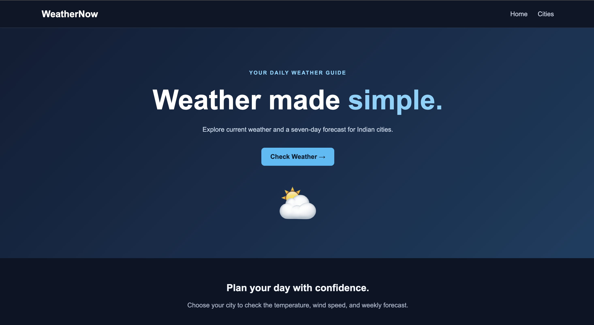
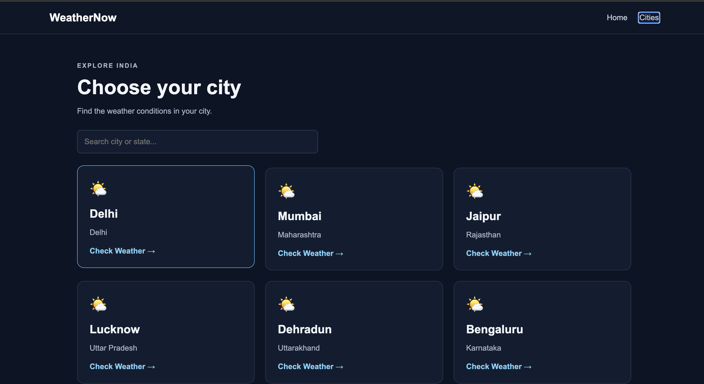

# Weather Now — PS5

A responsive weather application built using React and React Router. Users can explore Indian cities, check current weather conditions, and view a seven-day temperature forecast.

## Live Demo

**Live Website:** https://ps5-weather-now-ten.vercel.app/

**GitHub Repository:** https://github.com/karkichtn/ps5-weather-now

## Features

- View a home page with navigation to the city directory.
- Browse eight Indian cities.
- Search cities by city name or state.
- View the current temperature in Celsius.
- Check current wind speed in km/h.
- View a seven-day forecast with minimum and maximum temperatures.
- Navigate between pages using React Router.
- Display loading and error messages when fetching weather data.
- Show a custom 404 page for invalid routes.
- Responsive layout for desktop and mobile screens.

## Technologies Used

- React
- JavaScript
- Vite
- React Router DOM
- HTML
- CSS
- Open-Meteo Weather API

## API Used

This project uses the free Open-Meteo Forecast API to retrieve current weather conditions and daily temperature forecasts. No API key is required.

**API Documentation:** https://open-meteo.com/en/docs

## Routes

| Route              | Description                                                  |
| ------------------ | ------------------------------------------------------------ |
| `/`              | Home page                                                    |
| `/cities`        | List of Indian cities with search                            |
| `/weather/:city` | Current weather and seven-day forecast for the selected city |
| `*`              | Page not found                                               |

## Screenshots

### Home Page



### Cities Page



## Installation and Setup

Clone the repository:

```bash
git clone https://github.com/karkichtn/ps5-weather-now.git
```

Navigate to the project directory:

```bash
cd ps5-weather-now
```

Install the dependencies:

```bash
npm install
```

Start the development server:

```bash
npm run dev
```

Open the local URL displayed in your terminal.

## Production Build

To create a production build, run:

```bash
npm run build
```

The production files are generated in the `dist` directory.

## Deployment

The application is deployed on Vercel.

**Live URL:** https://ps5-weather-now-ten.vercel.app/

---

**Assignment:** PS5 — Weather Now
**Project Type:** React Weather Application
